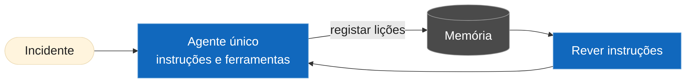
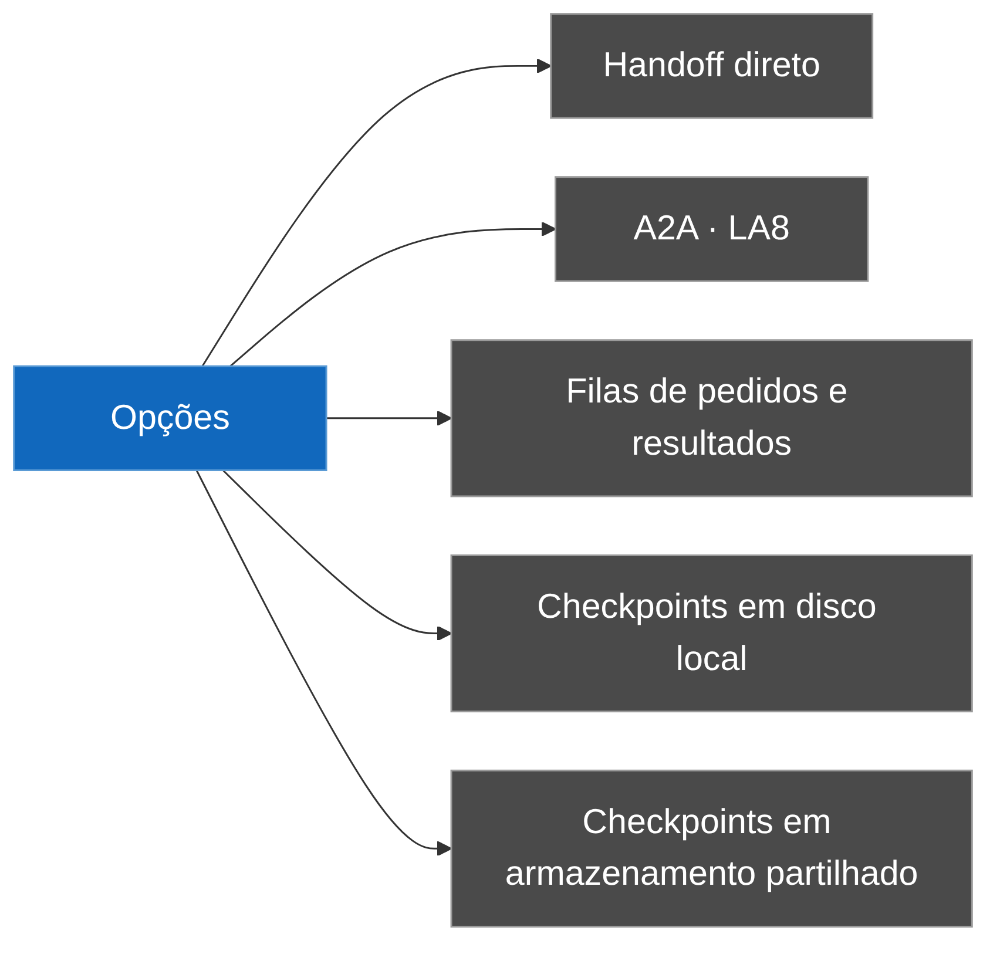
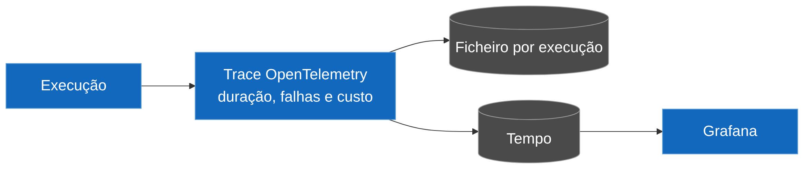
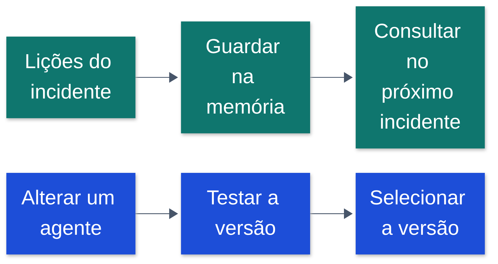
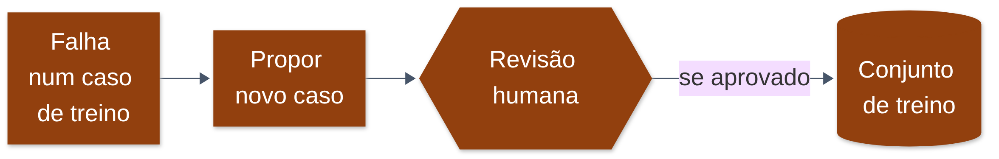

Curso 2 · Agentic AI

# Gestão de incidentes com agentes

João Sá

Meridian Exchange · 19 de novembro de 2026

<!--
~15 s. Abrir com o nome, o curso e o projeto, e anunciar o título da proposta.
-->

---

# Um agente

<!--
~30 s. Um único agente pode reunir as instruções, as ferramentas e a memória de lições. Entre incidentes, pode registar o que aprendeu e propor alterações às instruções. É o ponto de partida para explicar a divisão de papéis na equipa.
-->

---

# Resposta a incidentes

<!--
~60 s. O orquestrador recebe o alerta e coordena o diagnóstico. Rede e base de dados investigam em paralelo. O agente de operações de sistemas trata da remediação: pode reverter uma alteração ou reiniciar um serviço e pede aprovação para ações críticas. A etapa de recuperação inclui a correção e a verificação. O revisor consulta o estado do simulador e comunica o resultado ao orquestrador, que pode pedir nova tentativa.
-->

---

# Comunicação entre agentes

<!--
~25 s. Hoje a comunicação é em processo: quatro ferramentas ask_*, outputs Pydantic validados e handoffs registados com identificador estável, papéis, referências de evidência e tick, que aparecem nos traces. Na aula 8 fizemos um laboratório separado com A2A v1.0 simulado: Agent Card, SendMessage, GetTask, JSON-RPC, também em processo. Numa fila de mensagens, um agente publica uma tarefa e outro recolhe-a quando está disponível. Com checkpoints, um agente grava o estado e outro pode lê-lo para retomar o trabalho.
-->

---

# OpenTelemetry

<!--
~20 s. Cada corrida tem a sua trace, com workbench.run como raiz. A instrumentação do PydanticAI gera spans de agente, modelo e ferramenta; somamos tokens e custo por agente quando há preço. Antes de exportar, mascaramos e-mails, números de conta e telefones. Fica um ficheiro por corrida em results/. Na demonstração, as traces seguem também para o Tempo, onde podem ser consultadas no Grafana com TraceQL.
-->

---

# Ciclo de melhoria

<!--
~25 s. O orquestrador coordena a equipa. Depois de cada execução, usamos os resultados e os
traces para decidir o que atualizar. Há três possibilidades: memória, versões e casos de treino.
As atualizações podem influenciar incidentes futuros ou as próximas execuções de treino.
-->

---

# Memória e versões

<!--
~35 s. As lições ficam na memória para consulta em incidentes futuros. Para mudar uma versão,
o crítico ajuda a localizar a falha. Testamos uma alteração a um agente de cada vez, em treino
e validação. Uma pessoa decide qual a versão a usar.
-->

---

# Casos de treino

<!--
~25 s. Quando a equipa falha num caso de treino, podemos usar os resultados e os traces para
propor outro caso. Uma pessoa revê a proposta antes de a admitir no conjunto de treino.
Esse caso passa a fazer parte das próximas execuções de treino.
-->
