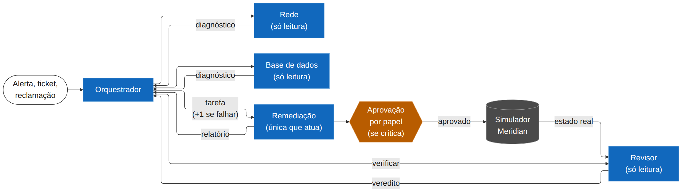

Projeto de curso · Curso 2: Agentic AI

# Uma equipa de incidentes que aprende com os erros

João Sá

Meridian Exchange · 19 de novembro de 2026

<!--
~15 s. Abrir com o nome, o curso e o projeto, e anunciar o título da proposta.
-->

---

Linha de base · um único agente

# Como eu faria isto com um agente só

- **Desenho:** um agente com prompt longo e memória; após cada incidente escreve as próprias lições, propõe a próxima versão do prompt e pontua-se com os seus próprios checks.
- **Atrativo:** uma só peça, um só loop, pouco encaminhamento entre agentes.
- **Limite:** quem melhora é quem avalia — sem revisor nem critérios independentes, o agente pode aprender a passar nos seus próprios testes em vez de resolver o incidente.

<!--
~30 s. Linha de base contrafactual: com um agente só, eu daria um prompt longo com todos os passos e uma memória de lições. Depois de cada corrida, o próprio agente resumia o erro, reescrevia o prompt e decidia se a nova versão era melhor pelos mesmos checks que ele usa. É simples e barato. O problema é que quem propõe a mudança é quem a avalia: não há revisor independente nem critérios fixos, e o agente pode aprender a passar nos próprios testes. É por isso que a proposta separa papéis e mantém o juiz fora do ciclo.
-->

---

Ciclo de execução · Meridian Exchange

# A execução normal: investigar, mitigar, verificar

- **Quando ativa:** chega um alerta, ticket ou reclamação; é a execução normal, em tempo real, desencadeada por cada incidente.
- **Permissões em código:** apenas a remediação atua, com aprovação por papel nas ações críticas.
- **Handoffs estruturados:** outputs validados entre agentes para preservar evidências e restrições.
- **Verificação real:** o revisor lê diretamente o simulador e reporta ao orquestrador, que aciona uma nova tentativa se a recuperação falhar.

<!--
~40 s. Ciclo de execução normal: responde a um alerta, ticket ou reclamação, em tempo real. O orquestrador coordena três especialistas; rede e base de dados só leem, a remediação é a única que atua e precisa de aprovação por papel nas ações críticas. O revisor lê o estado real e, se a recuperação falhar, o orquestrador envia uma correção. Os detalhes vêm nos slides seguintes.
-->

---

Especialização · equipa

# Cinco agentes, cinco especialidades

- **Config por papel:** cada agente tem instruções, ferramentas, limites e output tipado próprios, versionados em `harnesses/versions/<papel>/v1.yaml`.
- **Só a remediação atua:** rede, base de dados e revisor têm apenas ferramentas de leitura; a remediação detém `rollback_change`, `restart_instance`, `isolate_instance` e `failover`, com aprovação por papel nas ações críticas.
- **Orquestrador sem acesso direto:** decide a partir dos diagnósticos e pede ao revisor que confirme latência < 20 ms e erro < 1% no estado real.

<!--
~20 s. A especialização está no código: cinco papéis, cada um com ficheiro de versão próprio, instruções, catálogo de ferramentas, limites e tipo de saída. Rede, base de dados e revisor só leem; as quatro ações de remediação existem só na remediação e passam por aprovação nas ações críticas. O orquestrador não toca nos sistemas: decide e manda verificar.
-->

---

Comunicação entre agentes

# Handoffs hoje, protocolo A2A como caminho

- **No workbench:** o orquestrador chama `ask_network`, `ask_database`, `ask_remediation` e `ask_reviewer` como ferramentas PydanticAI, no mesmo processo. Cada especialista devolve um output tipado; os handoffs ficam registados com id, papéis, evidências e tick.
- **Na aula 8:** laboratório de A2A v1.0 simulado, com Agent Card, `SendMessage`/`GetTask` e JSON-RPC, ainda em processo, sem transporte de rede.
- **Contraste:** hoje a equipa partilha simulador, ferramentas e orçamento; um protocolo A2A abriria a porta a agentes remotos de outras equipas.

<!--
~25 s. Hoje a comunicação é em processo: quatro ferramentas ask_*, outputs Pydantic validados e handoffs registados com identificador estável, papéis, referências de evidência e tick, que aparecem nos traces. Na aula 8 fizemos um laboratório separado com A2A v1.0 simulado: Agent Card, SendMessage, GetTask, JSON-RPC, também em processo. A distinção é honesta: o workbench não usa A2A hoje; o protocolo é o próximo passo para agentes remotos.
-->

---

Observabilidade · OpenTelemetry

# Uma trace por corrida, mascarada antes de sair

- **Instrumentação:** `workbench.run` abre cada corrida; o PydanticAI gera spans de agente, modelo e ferramenta, e juntamos `meridian.agent_usage` com tokens e custo por agente quando o modelo tem preço.
- **Privacidade:** um exporter mascarado substitui e-mails, contas `ACC-######` e telefones; os detalhes dos checks ficam fora dos spans para o crítico não ver as respostas esperadas.
- **Saída:** `<run_id>.spans.json` por corrida em `results/`, exportação OTLP/HTTP para o Tempo quando configurada, e painel Grafana com consultas TraceQL para custo, falhas e duração.

<!--
~20 s. Cada corrida tem a sua trace, com workbench.run como raiz. A instrumentação do PydanticAI gera spans de agente, modelo e ferramenta; somamos tokens e custo por agente quando há preço. Antes de exportar, mascaramos e-mails, números de conta e telefones, e os checks nunca entram nos spans. Fica um ficheiro por corrida em results/ e, se houver endpoint, vai para o Tempo; o Grafana lê tudo com TraceQL.
-->

---

<!-- _class: dense -->

Ciclo de melhoria · entre execuções

# Um ciclo de melhoria, um juiz intocável

- **Quando ativa:** entre execuções, alimentado pelos traces OpenTelemetry de cada corrida; não intervém na execução normal em tempo real.
- **Salvaguarda:** checks, avaliador e revisor ficam fora do ciclo; a equipa não altera os critérios que a avaliam.

**Avaliação:** 60 casos (31 das aulas + 29 adaptados de postmortems públicos), em treino (38), validação (8) e teste reservado (14), sem misturar famílias de incidentes. Os checks validam efeitos, aprovações e recuperação sustentada no simulador, não só o texto do relatório. Todas as versões correm nos mesmos casos, com o mesmo estado inicial e memória congelada, em múltiplas repetições.

<!--
~85 s (total ~3m55s). Este é o ciclo de melhoria: só ativa entre execuções, a partir dos traces de cada corrida, e nunca mexe na execução normal em tempo real do primeiro slide. É um único ciclo, com três facetas alimentadas pelos mesmos traces. Um agente crítico analisa os traces e aponta o agente ou handoff responsável por cada falha. A faceta de versões altera um agente de cada vez e só promove a nova versão se o treino melhorar sem regressão na validação. A faceta de lições mantém uma memória por papel, atualizada após cada incidente e consultada antes de atuar. A faceta de novos casos parte de falhas reais, passa por revisão humana e entra só no treino. A salvaguarda é que checks, avaliador e revisor ficam fora do ciclo: a equipa melhora a resolução, nunca o critério de avaliação. Medimos isso com 60 casos, 31 das aulas e 29 de postmortems públicos, divididos por famílias em treino, validação e teste intacto até ao fim. Os checks leem o estado real do simulador e todas as versões correm nas mesmas condições, com repetições para controlar a variabilidade. Para abrir o Q&A: que falhas de coordenação entre agentes consideram mais relevantes incluir nos casos de avaliação?
-->
