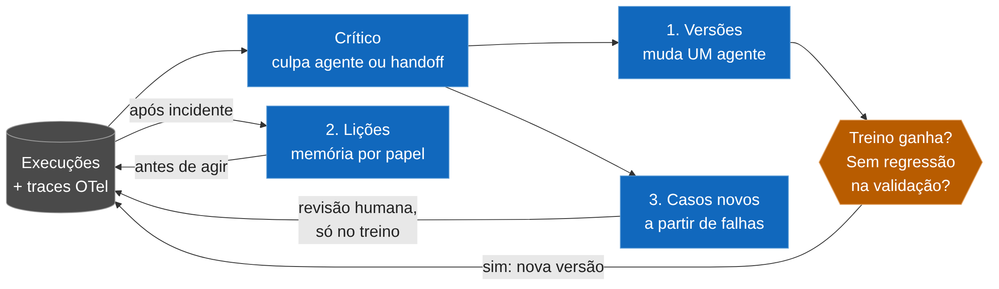

Curso 2 · Projeto · Meridian Exchange

# Uma equipa de incidentes que aprende com os próprios erros

- **Utilizador:** o engenheiro de serviço (on-call) de uma bolsa fictícia, a Meridian Exchange.
- **Problema:** alertas, tickets e reclamações descrevem o mesmo incidente por palavras diferentes; mitigar um componente crítico exige aprovação; um erro para a negociação.
- **Objetivo:** investigar, mitigar só com aprovação e **confirmar a recuperação com evidência**.
- **Aposta do projeto:** a equipa melhora entre execuções, medida sempre nos mesmos casos.

<!--
~25 s. Quem é o utilizador e porque é difícil: várias fontes, ações perigosas, aprovação obrigatória.
A aposta: não chega resolver um incidente, a equipa tem de melhorar de forma medida.
-->

---

Arquitetura e fluxo · base da sessão 7

# Orquestrador, três especialistas e um revisor

Fixo em código: permissões (só a remediação age), outputs Pydantic dos especialistas e acesso do revisor ao estado real. A fazer no workbench: aprovação por papel (o simulador já a suporta), ligar o revisor ao orquestrador com leitura verificada em código (na sessão 7 só corre na demo do runbook) e handoffs tipados entre agentes.

<!--
~45 s. Rede e base de dados só leem; só a remediação age, sempre com aprovação.
Os outputs dos especialistas são validados em Pydantic; no workbench, os handoffs entre agentes também passam a tipados para não perder restrições.
Na sessão 7 o revisor só corria na demo do runbook e sem verificar em código se leu o simulador; no workbench fica ligado ao orquestrador, obrigatório e com verificação de leitura em código, devolvendo à remediação uma vez se falhar.
-->

---

Ideia central · ciclos por construir (traces OTel já ativos)

# Três formas de melhorar, um único juiz

O ciclo nunca toca no juiz: checks, avaliador e revisor ficam fixos. Teste reservado até ao fim.

<!--
~55 s. O crítico lê os traces OpenTelemetry (já gravados pelo workbench) e culpa um agente ou handoff.
Três ciclos: (1) versões, mudando um agente de cada vez e só aceitando se o treino ganha sem regressão na validação; (2) lições por papel após cada incidente; (3) casos novos a partir de falhas, só no treino e com revisão humana.
Checks, avaliador e revisor ficam fora do alcance do ciclo: se pudesse mexer no juiz, aprendia a passar sem resolver.
-->

---

Avaliação e estado

# 60 casos, julgados pelo estado do simulador

- **31 casos das aulas + 29 adaptados de postmortems públicos** (CrowdStrike, Cloudflare, AWS S3, CME…).
- Os checks verificam **efeitos, aprovações e recuperação sustentada**, não só o texto do relatório.
- **Feito:** extensões ao simulador, workbench (`run`, `compare`, `requirements`), traces OTel com mascaramento, 60 casos e desenho da equipa.
- **Até 30 nov:** equipa no workbench (papel, MCP, retoma) → crítico sobre traces → ciclo de versões → lições → casos novos.

Limites: 37 de 60 checks são provisórios (8 de `s05–s09` à espera de soluções do formador; 29 adaptados de postmortems públicos). O teste final será pequeno (~15 casos), por isso as comparações vão correr com `--reps > 1` e métricas de variação (ainda por adicionar ao `compare`).

<!--
~35 s (total ~2m40s, 20 s de margem). Ser honesto: a infraestrutura de avaliação e os traces OTel estão prontos; a equipa ainda não corre no workbench.
Para abrir o Q&A (fora dos 3 min): que falhas de coordenação deviam entrar como casos?
-->
